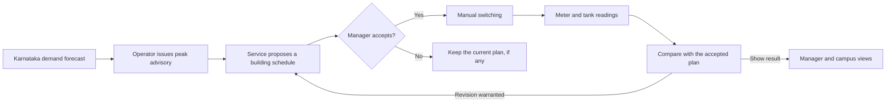
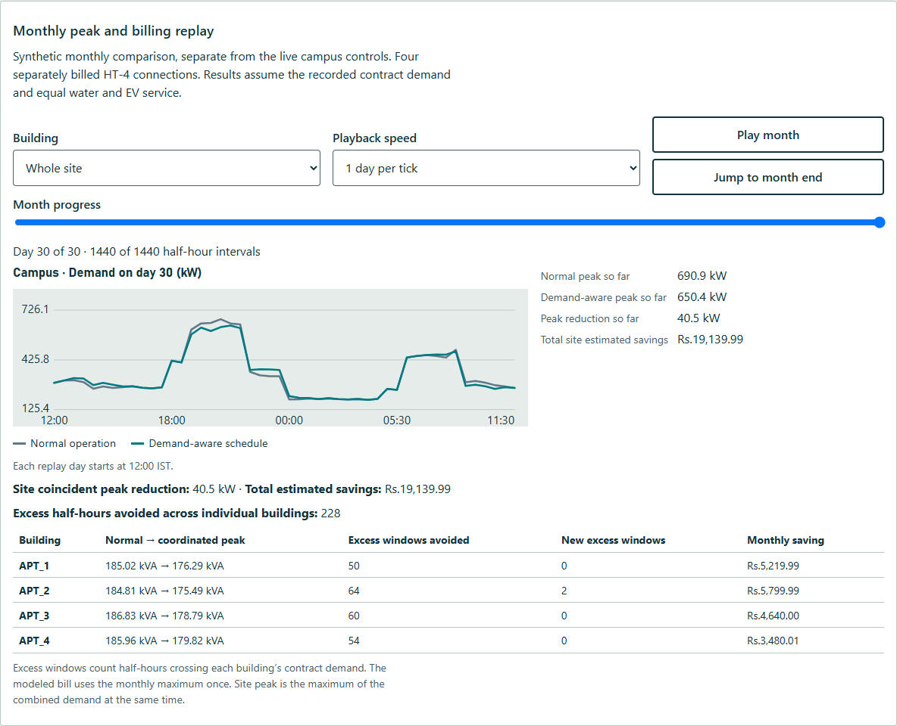

# NivaWatt

**Latest release · v4.0.0 · 3D demand charts and monthly savings**

The 3D campus adds live demand comparison, one-hour fast-forward, and a separate synthetic 30-day HT-4 billing replay.

[Download v4.0.0 ZIP](https://github.com/oxydevelopers/nivawatt-public/archive/refs/tags/v4.0.0.zip) · [Release notes and screenshots](https://github.com/oxydevelopers/nivawatt-public/releases/tag/v4.0.0)

NivaWatt is an advisory system for apartment water pumps and EV chargers. The operator picks peak hours from a Karnataka demand forecast. The service proposes a schedule that accounts for water reserves and charging deadlines. Each building manager decides whether to accept it, and meter and tank readings show what actually happened.

[Project plan and architecture](docs/PROJECT_PLAN.md) · [Research, results, and sources](docs/RESEARCH.md)

## How it works



In v4's separate synthetic monthly replay, the four-building coincident peak falls from **690.9 to 650.4 kW**. The four modeled HT-4 connections show **₹19,139.99 in estimated monthly savings** under the replay's tariff and service assumptions. The [research report](docs/RESEARCH.md#four-building-replay-in-v4) gives the per-building results, the baseline, and the limits of the estimate.

## Run locally

Extract the latest ZIP into a new folder and open a terminal in the folder containing `app.py`. Use Python 3.12. Create and activate a virtual environment, then run:

```sh
python -m pip install -r requirements.txt
python scripts/fetch_kptcl.py
python app.py
```

The download script retrieves the historical load archive from its original source. The archive is distributed by [Vonter/kptcl-load-curve](https://github.com/Vonter/kptcl-load-curve) under ODbL 1.0, with underlying KPTCL materials subject to their own rights. NivaWatt’s raw data stays in the local cache. The first start generates demo access codes in the local `config/local.json` file. Open that file locally for the operator and apartment manager codes.

Keep the server terminal open. Visit the [3D campus](http://127.0.0.1:8780/web/campus.html) and sign in with the operator code. If you launch with a different port, use the port shown in your terminal.

1. Open **Monthly peak and billing replay** and click **Jump to month end**. Use the building selector to inspect the combined site demand or a single building's peak and estimated bill.
2. To run the live simulation, click **Create the four-building demo** and **Issue approved windows to all four buildings**. Open each manager link from the campus page, use the corresponding code from `config/local.json`, and accept each proposed plan.
3. Back on the campus page, use **Set switches to accepted plans** followed by **Advance all buildings by 15 minutes**, or select **Fast-forward 1 hour on accepted plans**. Open **Live demand comparison** to see the normal and simulated demand as the runs progress.

For the original single-apartment workflow, start on the [Operator page](http://127.0.0.1:8780/operator) and follow its apartment manager link.

## Screenshots





## What the numbers represent

The forecast uses Karnataka state-level historical data. Apartment runs and device-emulator readings are synthetic. Monthly rupee figures, where available, are modeled estimates for separately billed HT-4 connections using matched service. The campus does not represent a live BESCOM deployment.

## Development

Run `python -m pytest tests/core -q` and `node --test tests/ui/ui.test.js` from the repository root. Forecast data checks use the local archive. See [contributors and responsibilities](CONTRIBUTING.md) for project roles.

## Releases

| Version | Features |
| --- | --- |
| [v4.0.0](https://github.com/oxydevelopers/nivawatt-public/releases/tag/v4.0.0) | Demand graphs, fast-forward, and monthly billing replay |
| [v3.0.0](https://github.com/oxydevelopers/nivawatt-public/releases/tag/v3.0.0) | Four-building 3D campus and apartment views |
| [v2.0.0](https://github.com/oxydevelopers/nivawatt-public/releases/tag/v2.0.0) | Apartment simulation and device emulator |
| [v1.0.0](https://github.com/oxydevelopers/nivawatt-public/releases/tag/v1.0.0) | Login, advisories, and scheduling |
