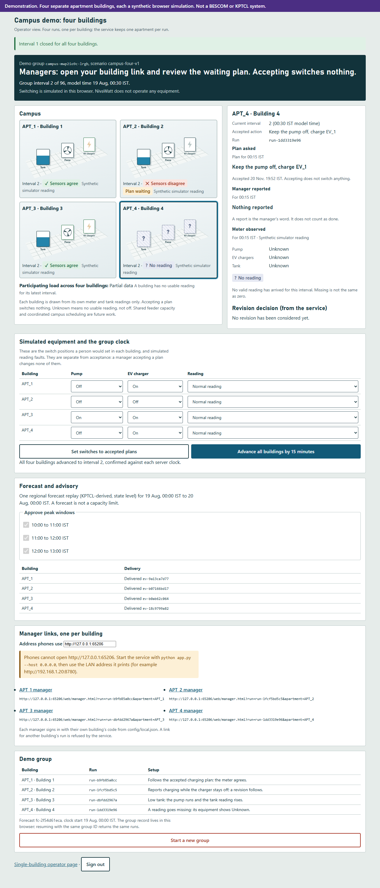
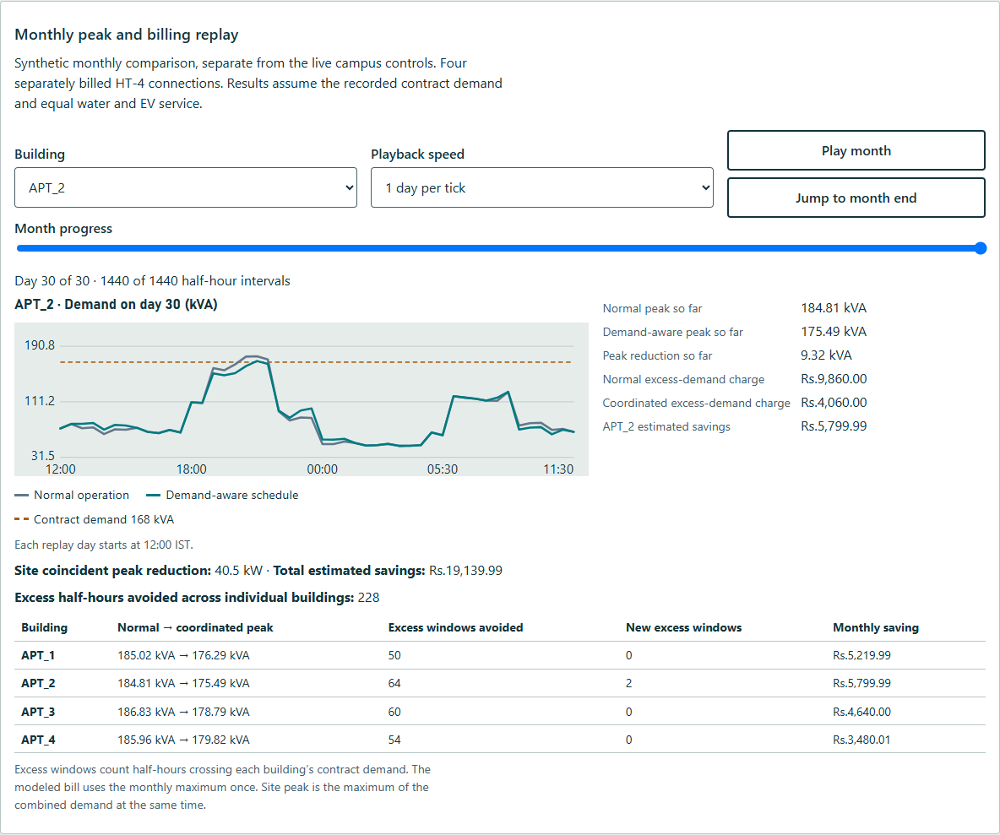

# NivaWatt

**v4.0.0 · 3D demand charts and monthly savings**

The 3D campus adds live demand comparison, one-hour fast-forward, and a separate synthetic 30-day HT-4 billing replay.

NivaWatt demonstrates how apartment buildings can schedule water pumps and EV chargers around a demand advisory, then use readings to verify what happened. A manager accepts each plan. Equipment switching in the demo is simulated.

## Run locally

Use Python 3.12. Create and activate a virtual environment, then run:

```sh
python -m pip install -r requirements.txt
python scripts/fetch_kptcl.py
python app.py
```

The download script retrieves the historical load archive from its original source. The archive is distributed by [Vonter/kptcl-load-curve](https://github.com/Vonter/kptcl-load-curve) under ODbL 1.0, with underlying KPTCL materials subject to their own rights. NivaWatt’s raw data stays in the local cache. The first start generates demo access codes in the local `config/local.json` file. Open that file locally for the operator and apartment manager codes.

Open [Operator](http://127.0.0.1:8780/operator) and [Apartment manager](http://127.0.0.1:8780/manager).
In Operator, load the saved forecast, start a browser run and issue the advisory. Open the manager link and accept the plan.
Open the [campus view](http://127.0.0.1:8780/web/campus.html), create the demo, and follow its next-step guide.
In the campus view, open **Live demand comparison** or **Monthly peak and billing replay**. Use **Jump to month end** for the final estimates.

## Screenshots





## What the numbers represent

The forecast uses Karnataka state-level historical data. Apartment runs and device-emulator readings are synthetic. Monthly rupee figures, where available, are modeled estimates for separately billed HT-4 connections using matched service. The campus does not represent a live BESCOM deployment.

## Development

Run `python -m pytest tests/core -q` and `node --test tests/ui/ui.test.js` from the repository root. Forecast data checks use the local archive. See [contributors and responsibilities](CONTRIBUTING.md) for project roles.
