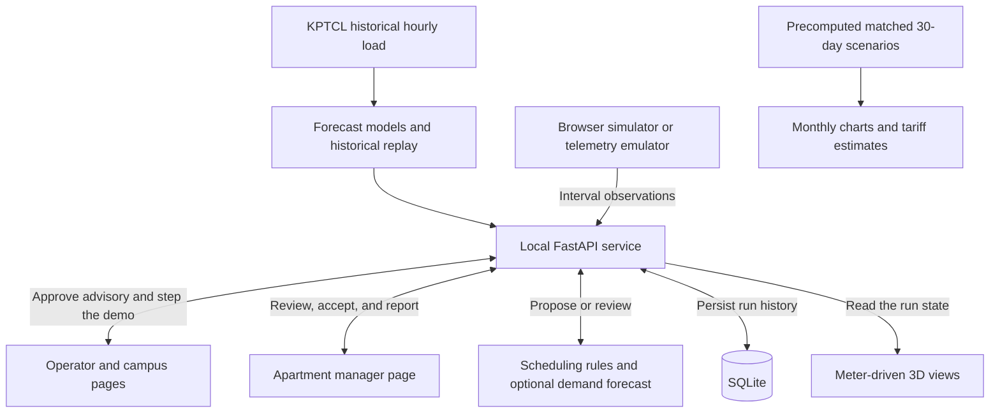

# NivaWatt project plan

[Repository overview](../README.md) · [Research and results](RESEARCH.md)

## Problem and approach

An apartment can sometimes move water pumping or EV charging to a different hour and still deliver the same service. The building manager needs a schedule they can carry out, a way to tell whether it worked, and a way to see the effect on the building's peak. NivaWatt connects those steps and makes the assumptions behind its savings estimates visible.

There are three distinct numbers in the design.

| Number | Where it comes from | How it is used |
| --- | --- | --- |
| Regional peak advisory | Operator-approved hours from a Karnataka state-grid forecast in MW | Helps decide when to shift flexible load |
| Participating-load allowance | Configured limit in kW for the pump and EV circuits | Constrains the proposed schedule |
| Whole-connection demand target | A planning value informed by connection demand, tariff assumptions and the local load forecast | Guides demand-aware scheduling. Electrical protection remains the responsibility of the installation. |

## System architecture

The operator can open a one-building run or a four-building campus group. Each campus building keeps its own run, plan, meter state and manager access. The campus coordinates the demo clock across buildings and combines their timestamp-aligned demand traces for comparison. The schedule carried out in the live demo affects the live chart. The monthly replay reads a separate, precomputed synthetic comparison.

## Scheduling and verification

1. The operator reviews the regional forecast and publishes the selected peak windows.
2. The service proposes pump and EV slots using the estimated tank state, water reserve, pump operating limits, EV energy and departure deadline, and participating-load allowance.
3. For new runs the requested default is **experimental demand-aware scheduling**. With usable whole-connection history and current observations, it forecasts background load from past intervals, after deducting the participating pump and EV channels from the whole-connection reading. Explicit advisory-only selection is supported. The service falls back to advisory-only planning when connection history or readings are missing, insufficient, or stale. In the public demo the whole-connection channel, where configured, is synthetic.
4. The manager accepts or declines the current proposal. An accepted plan is a commitment. A later mode change or revision proposal preserves that commitment until the manager accepts another plan.
5. In the simulator, the operator sets the manual switch positions and advances the clock. The manager's execution report is recorded separately. At interval close the service can show a match, a disagreement, or an unverified outcome. The 3D scene follows observed readings. Missing readings appear as unknown.
6. If a disagreement warrants a revision, the manager sees the new proposal. In the demo, reporting “charging started” with the charger still off shows why this matters.

## Validation plan

| Stage | What to verify | Status |
| --- | --- | --- |
| Forecast and advisory | Use issue-time inputs, compare peak-hour metrics and evaluate on a fresh chronological period | Historical replay and backtests complete. Expanded candidates need a new holdout and publication-time checks. |
| Single-building simulation | Show plan, manual action, independent observation, discrepancy, and revised acceptance | Implemented in the demo. Tests cover delayed readings, stale proposals, and run or session changes. |
| Campus and billing replay | Compare matched normal and scheduled runs at building and site level, check service and report rebound, excess demand, and workload | Four-building demo and synthetic replay released in v4. |
| Low-voltage bench | Calibrate tank and circuit sensors, verify manual switch actions and missing/restarted readings, and check the mapping between physical and model intervals | Proposed. The device emulator is available for testing the telemetry path. |
| Building pilot | Confirm the connection's tariff, measure whole-connection demand with authorization, and record matched service and real manager follow-through | Requires an authorized site and calibrated measurement. |
| Distribution utility evaluation | Add time-aligned buildings on an actual feeder and compare coincident peak, rebound, and the cost of the intervention | Requires feeder telemetry and utility cost inputs. |

## Proposed bench

Use a low-voltage recirculating water loop with a small DC pump, a top-tank level sensor, and a separate switched dummy EV load. A prototype ESP32 would report each branch's power and the tank reading to the local service over Wi-Fi. The laptop runs the service and campus view. The phone shows the manager page. Manual switches are the control point.

First check sensor calibration, safe pump operation, and repeatability. Then run one match, one reported action with the load left off, one missing reading, and one recovery. Compare the service verdict and the 3D view at each step. Record raw readings and any electrical or volume scaling. Establish the energy basis before compressing model time, because energy counted by a real meter depends on elapsed physical time.

A physical apartment deployment needs an authorized whole-connection measurement in addition to branch and tank sensors. The utility meter interface, installation method, and billing-demand interval must be confirmed with the site and utility. The bench demonstrates the telemetry and verification workflow under controlled conditions.
